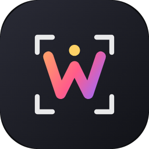

<p align="center">
  
</p>

<h1 align="center">Wallpaper Editor</h1>

<p align="center">
  <a href="https://github.com/AnxoBT/wallpaper-editor/releases/latest"></a>
  
  
  
  
  
  <a href="LICENSE"></a>
</p>

<br>

<details open>
<summary><b>English</b></summary>

<br>

<p align="center">Make any photo fit your screen, then turn your gallery into a live wallpaper.</p>

<p align="center"><a href="https://github.com/AnxoBT/wallpaper-editor/releases/latest"><b>Download</b></a> · Android APK · Windows installer or portable zip · iPhone IPA (test)</p>

<table>
  <tr>
    <td width="33%" valign="top">
      <h3>🎨 Editor</h3>
      Fits any image to your exact screen resolution. Crop, expand with smart fill, remove objects or text with on-device AI, and save over the original without changing its place in the gallery.
    </td>
    <td width="33%" valign="top">
      <h3>🖼️ Live wallpaper</h3>
      Cycles through your folders. Double tap for the next photo, triple tap to go back, or let it change on its own. No battery use in the background.
    </td>
    <td width="33%" valign="top">
      <h3>🕒 Clock widget</h3>
      A home-screen clock with your choice of font, size and date, in a colour that adapts to each wallpaper.
    </td>
  </tr>
</table>


### Features

**Editor**

- **Frame**: target resolution (your screen's by default, or any custom size); move, zoom and
  rotate with gestures or in precise steps (1 px, 1 %, 0.1°), with snapping to edges and centre;
  fill empty areas with blur, white or black
- **Crop** freely or to a fixed ratio
- **Expand** any side: a clean background, or new texture (clouds, stars, grain, gradients) invented from the photo without repeating patterns
- **Heal**: remove spots, objects, signatures and text (also CJK, @ and ©) using on-device AI or
  the classic fill; **Blend** and **Shuffle** brushes to retouch joins and textures by hand
- **Layers**: place other images on top, then keep editing the combined result
- Filters, adjustments, curves, HDR, Glamour, Drama, lens blur, selective brush, vignette and grain
- Undo and redo history, and compare with the original at any time
- See the edited photo full screen with the clock on top: the app's home-screen clock and, on phones
  whose lock-screen clock can be read (vivo), the lock-screen one too
- Save as a copy (next to the original, or in a folder you choose) or **replace the original**
  (same name, date and position in its folder), and set it as wallpaper straight away
- Recently edited photos one tap away; the photo picker opens the last folder you used; a warning
  before leaving with unsaved changes

**Tags**

- Tag photos with as many labels as you like (series, anime, a character…) and mark favourites
  with a heart; tags live in the app, your photos are never modified
- Find photos by tag in the picker and in the wallpaper list: type to narrow the tags, tap a tag
  once to require it, twice to exclude it, three times to remove it. Several tags combine (all the
  required ones, none of the excluded ones), and each shows how many photos really have it
- See the photos without tags, and open any photo in your gallery app
- Create, rename or delete tags, and import or export them as JSON
- Copies saved from the editor keep the original's tags
- Copy every photo with a tag into a new folder (for example to use them in another app)

**Live wallpaper**

- Sources: whole folders (new photos are added automatically) or selected photos, each with its
  own schedule: always, daytime, night, weekdays or weekend
- Filter the slideshow by tags, with the same include/exclude taps; "See all" shows the filtered
  photos and can show the rest too
- Double and triple tap on the home screen, each with its own action: next, previous, random
  photo or pause/resume the automatic change
- Shuffle or sequential order, automatic change on unlock or on a timer
- By time of day (optional): only dark photos at night, so the screen doesn't dazzle; any by day
- Home screen only, or home and lock screen
- Edit or delete the current wallpaper photo from inside the app (deleting can be undone, and the
  wallpaper goes back to the previous photo)
- List the photos whose shape doesn't match your screen, to fix them in the editor
- Find duplicate photos, also the same image saved at another size, with the one worth keeping
  marked
- Nothing runs in the background while the wallpaper isn't visible

**Clock widget**

- Several fonts and sizes, date above or below, 12/24 h, shadow and alignment
- Colour that adapts to each wallpaper; freely resizable
- A style that copies the vivo lock-screen clock

**Settings**

- English and Spanish; follows your phone's language by default
- Manage tags, import and export them, and read the open-source licences
- Tells you when a new version is on GitHub (checked at most once a day when you open the app, or by
  hand); that is the only time it goes online

### Windows version

The same editor, tags and tag search run on Windows, and the wallpaper part becomes a desktop slideshow. Download the installer or the portable zip from the release.

- Photos come from folders you choose (Pictures at first); tags use the same JSON file as the phone, matched by file name
- The mouse wheel zooms and Shift + wheel rotates, where the phone uses pinch and two fingers
- The slideshow changes while the app is open or in the system tray
- Not on Windows: AI healing and text detection (classic healing is there), the clock widget, tap gestures and the lock screen
- Also on Windows: requiring and excluding tags, and copying a tag to a folder
- It is not signed, so Windows SmartScreen may warn the first time

### iPhone version (test)

iOS does not let any app change the wallpaper by itself, so the iPhone version works together with the Shortcuts app. It is a small app (in `ios/`) with the wallpaper part only:

- Choose where photos come from (all photos, albums such as Favorites, or single photos), shuffle or in order, and whole photo over a blurred copy or fill the screen
- It adds the Shortcuts actions "Next wallpaper", "Previous wallpaper" and "Random wallpaper", which return the photo already fitted to the screen; followed by iOS's "Set Wallpaper Photo" they change the wallpaper
- A guide in the app shows how to run them with Back Tap (double and triple tap on the back of the iPhone), from a home screen widget, or on a schedule
- The IPA in the release is unsigned: sign it when installing, for example with Sideloadly or AltStore (with a free Apple ID it has to be reinstalled every 7 days). It has been built and tested in the iOS simulator, not yet on a real iPhone
- It is built by GitHub Actions (`.github/workflows/ios.yml`) with XcodeGen and Xcode

### Install

From the [latest release](https://github.com/AnxoBT/wallpaper-editor/releases/latest):

- **Android**: `WallpaperEditor-<version>.apk`; open it on your phone (Android 8.0 or later; allow
  installing from unknown sources when asked). Every version is signed with the same release key,
  so new versions install over the previous one and keep your settings. If you installed the first
  test build (v1.0), uninstall it first (it used a temporary key).
- **Windows**: `WallpaperEditor-<version>-Windows.msi` installs it for your user;
  `WallpaperEditor-<version>-Windows-portable.zip` runs without installing (`WallpaperEditor.exe`).
- **iPhone (test)**: `WallpaperEditor-<version>-iOS.ipa`, unsigned; install it with Sideloadly or
  AltStore.

### Compatibility

**Requirements**: Android 8.0 (API 26) or later. No Google Play services needed: the AI model and
text detection are bundled and run offline. A launcher that supports live wallpapers and widgets
(almost all do; some Android Go phones don't have live wallpapers).

**Where it has been tested**

| Platform | Device | Status |
|---|---|---|
| Android | vivo V40 SE, Android 14, 1080 × 2400 | Tested daily |
| Android | Emulators (stock Android): 8.0 (1080 × 1920), 14 (small phone 720 × 1280 and tablet), 16 (1080 × 2400) | Editor, live wallpaper, double tap and clock widget tested |
| Android | Other brands (Samsung, Xiaomi, Pixel, OnePlus…) | **Not tested yet** |
| Windows | Windows 11 | Tested |
| iPhone | iOS 26 simulator | Tested in the simulator only |

The app uses standard Android APIs and never checks the phone brand, so it is expected to work on
any phone. But every manufacturer changes parts of Android, and so far it has only been tested on
one vivo phone and in emulators. Reports from other phones are welcome (see below).

**What works on every phone, and what needs vivo**

| Feature | Any Android | Only on vivo |
|---|---|---|
| Editor, layers, filters, AI healing, saving | ✓ | |
| Tags, picker, duplicates, photos that don't fit | ✓ | |
| Live wallpaper, schedules, by time of day | ✓ | |
| Double and triple tap on the wallpaper | ✓ (if the launcher passes taps on) | |
| Home and lock screen wallpaper | ✓ (some brands override the lock screen) | |
| Clock widget: fonts, size, date, automatic and accent colours | ✓ | |
| Clock widget: copy the lock-screen clock (exact font, weight and colour) | Similar look (Playfair Display Black, colour calculated by the app) | ✓ exact |
| Editor preview with the home-screen clock | ✓ | |
| Editor preview with the lock-screen clock | | ✓ |
| Update notice | ✓ | |

Why some things are vivo-only: vivo stores the style and colour of its lock-screen clock in a
system setting that apps can read. Other brands keep it private, and Android has no public way
to ask for it, so on those phones the app shows its own clock instead of guessing.

**Known differences between brands** (expected from how each system works; not yet confirmed on
those phones)

- **Taps on the wallpaper**: the launcher has to pass taps on to the live wallpaper. Most do; if
  double tap does nothing, try another launcher.
- **Lock screen**: some systems (for example Xiaomi/HyperOS "wallpaper carousel", or lock-screen
  themes) put their own image on the lock screen. Turn those off so the app's photo is shown.
- **Battery savers**: the app does nothing in the background, but aggressive battery savers may
  stop the live wallpaper or the widget updates. If the wallpaper stops changing, allow the app
  to run without restrictions in the battery settings.
- **Widget size**: each launcher decides the widget box, so the clock can look bigger or smaller
  than in the app's preview; resize the widget to fit.
- **Lock screen with a live wallpaper**: some systems show the live wallpaper on the lock screen
  and others show a still image; with "home and lock screen" chosen, the app sets both, so either
  way you see the current photo.

**Reporting a problem**

[Open an issue](https://github.com/AnxoBT/wallpaper-editor/issues/new/choose) with the phone
model, Android version, launcher, what you did and what happened. Screenshots help. Reports that
it *works* on a phone are useful too.

### Build

Requires JDK 17 and the Android SDK (compile/target SDK 35, min SDK 26).

```sh
./gradlew assembleRelease           # APK in app/build/outputs/apk/release/
./gradlew testReleaseUnitTest        # unit tests
./gradlew ktlintCheck                # code style (ktlintFormat fixes it)
```

Clock widget layouts are generated by `python tools/gen_clock_layouts.py`.

Windows (same JDK, from the same Gradle project):

```sh
./gradlew :desktop:test               # tests, with screenshots in desktop/build/tour
./gradlew :desktop:packageMsi          # installer (createDistributable for the portable folder)
```

iPhone (on a Mac with Xcode; GitHub Actions does it on every change in `ios/`):

```sh
cd ios && xcodegen generate          # creates WallpaperEditor.xcodeproj
xcodebuild test -scheme WallpaperEditor -destination "platform=iOS Simulator,name=iPhone 17 Pro"
```

### How it works

- **Smart fill** (Expand and Heal): multi-scale patch synthesis based on PatchMatch, with detail
  restored at full resolution and tone matched along the seam.
- **New texture** (Expand): the photo's own grain and detail are rebuilt band by band (a
  Laplacian pyramid with matched histograms) over a smooth stretch of its edges, so skies, stars
  and gradients continue without copies of the same patch.
- **Duplicates**: each photo is reduced to a tiny fingerprint of its shape and colours, so the
  same image is found at another size or compression, while different photos on black do not match.
- **On-device AI**: [MI-GAN](https://github.com/Picsart-AI-Research/MI-GAN) (MIT) running with
  LiteRT on the GPU, with CPU fallback. Text detection uses on-device ML Kit.
- **Your data**: settings survive app updates. Android backup only keeps preferences that work on
  any phone, plus photo tags (stored by file name); chosen folders and photos are not backed up,
  because their permissions only apply to the phone where they were granted.

### Credits

Clock fonts are licensed under the SIL Open Font License. The lock-screen style uses the phone's
own lock-screen font when the system exposes it (vivo), and Playfair Display Black otherwise. All open-source licences can be read in the app under **Settings → Open-source licences**.

### License

Copyright © 2026 AnxoBT. Licensed under the [GNU General Public License v3.0](LICENSE): you can
use, study, share and modify it, but anything you distribute that is based on this code must be
released under the same licence, with its source code.

</details>

<details>
<summary><b>Español</b></summary>

<br>

<p align="center">Adapta cualquier foto a tu pantalla y convierte tu galería en un fondo de pantalla dinámico.</p>

<p align="center"><a href="https://github.com/AnxoBT/wallpaper-editor/releases/latest"><b>Descargar</b></a> · APK de Android · instalador o zip portable de Windows · IPA de iPhone (prueba)</p>

<table>
  <tr>
    <td width="33%" valign="top">
      <h3>🎨 Editor</h3>
      Adapta cualquier imagen a la resolución exacta de tu pantalla. Recorta, expande con relleno inteligente, borra objetos o textos con IA en el móvil y guarda encima del original sin cambiar su sitio en la galería.
    </td>
    <td width="33%" valign="top">
      <h3>🖼️ Fondo dinámico</h3>
      Va pasando las fotos de tus carpetas. Doble toque para la siguiente, triple para volver, o deja que cambie sola. Sin consumo en segundo plano.
    </td>
    <td width="33%" valign="top">
      <h3>🕒 Widget de reloj</h3>
      Un reloj para el escritorio con la fuente, el tamaño y la fecha que elijas, en un color que se adapta a cada fondo.
    </td>
  </tr>
</table>


### Funciones

**Editor**

- **Encuadre**: resolución de destino (por defecto la de tu pantalla, o la que quieras); mover,
  ampliar y girar con gestos o en pasos precisos (1 px, 1 %, 0,1°), con imán a los bordes y al
  centro; rellenar los huecos con desenfoque, blanco o negro
- **Recortar** libre o con proporción fija
- **Expandir** cualquier lado: fondo limpio, o textura nueva (nubes, estrellas, grano, degradados) inventada a partir de la foto sin repetir patrones
- **Corrector**: borra manchas, objetos, firmas y textos (también chino o japonés, @ y ©) con IA en
  el propio móvil o con el relleno clásico; pinceles **Mezclar** y **Revolver** para retocar uniones
  y texturas a mano
- **Capas**: pon otras imágenes encima y sigue editando el resultado combinado
- Filtros, ajustes, curvas, HDR, Glamour, Drama, desenfoque de lente, pincel selectivo, viñeta y
  grano
- Historial para deshacer y rehacer, y comparar con el original en cualquier momento
- Ver la foto editada a pantalla completa con el reloj encima: el del escritorio de la app y, en los
  móviles que dejan leer su reloj de bloqueo (vivo), también ese
- Guardar como copia (junto a la original o en la carpeta que elijas) o **reemplazar el original**
  (mismo nombre, fecha y posición en su carpeta), y ponerla de fondo al momento
- Fotos editadas hace poco a un toque; el selector abre la última carpeta que usaste; aviso antes
  de salir con cambios sin guardar

**Etiquetas**

- Pon a cada foto las etiquetas que quieras (series, anime, un personaje…) y márcala como favorita
  con un corazón; las etiquetas se guardan en la app, tus fotos no se tocan
- Busca fotos por etiqueta en el selector y en la lista de fondos: escribe para encontrar la
  etiqueta y tócala una vez para exigirla, dos para excluirla y tres para quitarla. Varias se
  combinan (todas las exigidas y ninguna de las excluidas), y cada una muestra cuántas fotos la
  tienen de verdad
- Ver las fotos sin etiquetas, y abrir cualquier foto en tu app de galería
- Crea etiquetas, cámbiales el nombre o bórralas, e impórtalas o expórtalas en JSON
- Las copias guardadas desde el editor conservan las etiquetas de la original
- Copia todas las fotos de una etiqueta a una carpeta nueva (por ejemplo, para usarlas en otra app)

**Fondo dinámico**

- Fuentes: carpetas enteras (las fotos nuevas entran solas) o fotos sueltas, cada una con su
  horario: siempre, de día, de noche, entre semana o fin de semana
- Filtrar el pase por etiquetas, con los mismos toques de exigir y excluir; «Ver todas» enseña las
  del filtro y también puede enseñar el resto
- Doble y triple toque en el escritorio, cada uno con su acción: siguiente, anterior, foto al azar
  o pausar/reanudar el cambio automático
- Orden aleatorio o secuencial, cambio automático al desbloquear o cada cierto tiempo
- Según la hora (opcional): de noche solo fotos oscuras, para que no deslumbre; de día, cualquiera
- Solo en el escritorio, o también en la pantalla de bloqueo
- Editar o borrar la foto del fondo actual desde la propia app (el borrado se puede deshacer y el
  fondo vuelve a la foto anterior)
- Ver qué fotos no tienen la forma de tu pantalla, para arreglarlas en el editor
- Buscar fotos repetidas, también la misma imagen en otro tamaño, con la que conviene guardar
  marcada
- Nada funciona en segundo plano mientras el fondo no se ve

**Widget de reloj**

- Varias fuentes y tamaños, fecha encima o debajo, 12/24 h, sombra y alineación
- Color que se adapta a cada fondo; tamaño ajustable
- Un estilo que copia el reloj de bloqueo de vivo

**Ajustes**

- Inglés y español; por defecto usa el idioma de tu móvil
- Gestionar las etiquetas, importarlas y exportarlas, y leer las licencias de código abierto
- Avisa cuando hay una versión nueva en GitHub (lo mira como mucho una vez al día al abrir la app,
  o a mano); es lo único para lo que se conecta a internet

### Versión de Windows

El mismo editor, las etiquetas y su búsqueda funcionan en Windows, y la parte de fondos pasa a ser un pase en el escritorio. Descarga el instalador o el zip portable desde la release.

- Las fotos salen de las carpetas que elijas (al principio, Imágenes); las etiquetas usan el mismo JSON que el móvil y van por nombre de archivo
- La rueda del ratón hace zoom y Mayús + rueda gira, donde el móvil usa pellizco y dos dedos
- El pase cambia mientras la app está abierta o en la bandeja del sistema
- No está en Windows: Corrector con IA y detección de texto (sí el Corrector clásico), widget del reloj, gestos con toques y pantalla de bloqueo
- También en Windows: exigir y excluir etiquetas, y copiar una etiqueta a una carpeta
- No está firmada, así que Windows SmartScreen puede avisar la primera vez

### Versión de iPhone (prueba)

iOS no deja que ninguna app cambie el fondo por su cuenta, así que la versión de iPhone funciona junto a la app Atajos. Es una app pequeña (en `ios/`) solo con la parte de fondos:

- Eliges de dónde salen las fotos (todas, álbumes como Favoritas o fotos sueltas), al azar o en orden, y foto entera con la misma desenfocada detrás o llenando la pantalla
- Añade a Atajos las acciones «Siguiente fondo», «Fondo anterior» y «Fondo al azar», que dan la foto ya ajustada a la pantalla; seguidas de «Establecer foto como fondo» de iOS, cambian el fondo
- Una guía en la app explica cómo lanzarlas con el Toque posterior (doble y triple toque en la parte de atrás del iPhone), desde un widget del escritorio o por horario
- El IPA de la release no está firmado: se firma al instalarlo, por ejemplo con Sideloadly o AltStore (con un Apple ID gratuito hay que reinstalarlo cada 7 días). Está compilada y probada en el simulador de iOS, todavía no en un iPhone de verdad
- La compila GitHub Actions (`.github/workflows/ios.yml`) con XcodeGen y Xcode

### Instalar

Desde la [última versión](https://github.com/AnxoBT/wallpaper-editor/releases/latest):

- **Android**: `WallpaperEditor-<version>.apk`; ábrelo en el móvil (Android 8.0 o superior; permite
  instalar apps de origen desconocido si te lo pide). Todas las versiones van firmadas con la misma
  clave, así que cada una se instala encima de la anterior y conserva tus ajustes.
- **Windows**: `WallpaperEditor-<version>-Windows.msi` la instala para tu usuario;
  `WallpaperEditor-<version>-Windows-portable.zip` funciona sin instalar (`WallpaperEditor.exe`).
- **iPhone (prueba)**: `WallpaperEditor-<version>-iOS.ipa`, sin firmar; se instala con Sideloadly o
  AltStore.

### Compatibilidad

**Requisitos**: Android 8.0 (API 26) o superior. No hacen falta los servicios de Google Play: el
modelo de IA y la detección de texto van dentro de la app y funcionan sin conexión. Un escritorio
(launcher) que admita fondos dinámicos y widgets (casi todos; algunos móviles Android Go no tienen
fondos dinámicos).

**Dónde se ha probado**

| Plataforma | Dispositivo | Estado |
|---|---|---|
| Android | vivo V40 SE, Android 14, 1080 × 2400 | Probada a diario |
| Android | Emuladores (Android puro): 8.0 (1080 × 1920), 14 (móvil pequeño 720 × 1280 y tablet), 16 (1080 × 2400) | Editor, fondo dinámico, doble toque y widget de reloj probados |
| Android | Otras marcas (Samsung, Xiaomi, Pixel, OnePlus…) | **Sin probar todavía** |
| Windows | Windows 11 | Probada |
| iPhone | Simulador de iOS 26 | Solo en el simulador |

La app usa las funciones estándar de Android y no mira la marca del móvil en ningún momento, así
que debería funcionar en cualquiera. Pero cada fabricante cambia partes de Android, y de momento
solo se ha probado en un móvil vivo y en emuladores. Se agradecen pruebas en otros móviles (ver abajo).

**Qué funciona en todos los móviles y qué necesita vivo**

| Función | Cualquier Android | Solo en vivo |
|---|---|---|
| Editor, capas, filtros, Corrector con IA, guardar | ✓ | |
| Etiquetas, selector, repetidas, fotos que no encajan | ✓ | |
| Fondo dinámico, horarios, según la hora | ✓ | |
| Doble y triple toque en el fondo | ✓ (si el escritorio pasa los toques) | |
| Fondo de escritorio y de bloqueo | ✓ (algunas marcas tapan el bloqueo) | |
| Widget de reloj: fuentes, tamaño, fecha, colores automático y de acento | ✓ | |
| Widget de reloj: copiar el reloj de bloqueo (fuente, grosor y color exactos) | Aspecto parecido (Playfair Display Black, color calculado por la app) | ✓ exacto |
| Vista previa del editor con el reloj del escritorio | ✓ | |
| Vista previa del editor con el reloj de bloqueo | | ✓ |
| Aviso de versión nueva | ✓ | |

Por qué hay cosas solo para vivo: vivo guarda el estilo y el color de su reloj de bloqueo en un
ajuste del sistema que las apps pueden leer. Las demás marcas no lo publican y Android no tiene
una forma pública de pedirlo, así que en esos móviles la app enseña su propio reloj en vez de
inventárselo.

**Diferencias conocidas entre marcas** (esperables por cómo funciona cada sistema; aún sin
confirmar en esos móviles)

- **Toques en el fondo**: el escritorio tiene que pasar los toques al fondo dinámico. La mayoría
  lo hace; si el doble toque no hace nada, prueba con otro escritorio.
- **Pantalla de bloqueo**: algunos sistemas (por ejemplo el "carrusel de fondos" de Xiaomi/HyperOS
  o los temas de bloqueo) ponen su propia imagen en el bloqueo. Desactívalos para que se vea la
  foto de la app.
- **Ahorro de batería**: la app no hace nada en segundo plano, pero los ahorros de batería más
  agresivos pueden parar el fondo dinámico o el widget. Si el fondo deja de cambiar, permite que la
  app funcione sin restricciones en los ajustes de batería.
- **Tamaño del widget**: cada escritorio decide la caja del widget, así que el reloj puede verse
  más grande o más pequeño que en la vista previa; cambia el tamaño del widget para ajustarlo.
- **Bloqueo con fondo dinámico**: unos sistemas muestran el fondo dinámico en el bloqueo y otros
  una imagen fija; con "escritorio y bloqueo" elegido, la app pone los dos, así que en ambos casos
  se ve la foto actual.

**Avisar de un problema**

[Abre una incidencia](https://github.com/AnxoBT/wallpaper-editor/issues/new/choose) con el modelo
del móvil, la versión de Android, el escritorio, qué hiciste y qué pasó. Las capturas ayudan. Que
*funciona* en un móvil también es útil saberlo.

### Compilar

Necesita JDK 17 y el Android SDK (compile/target SDK 35, min SDK 26).

```sh
./gradlew assembleRelease           # APK en app/build/outputs/apk/release/
./gradlew testReleaseUnitTest        # tests
./gradlew ktlintCheck                # estilo de código (ktlintFormat lo corrige)
```

Los diseños del widget de reloj se generan con `python tools/gen_clock_layouts.py`.

Windows (el mismo JDK, desde el mismo proyecto de Gradle):

```sh
./gradlew :desktop:test               # tests, con capturas en desktop/build/tour
./gradlew :desktop:packageMsi          # instalador (createDistributable para la carpeta portable)
```

iPhone (en un Mac con Xcode; GitHub Actions lo hace con cada cambio en `ios/`):

```sh
cd ios && xcodegen generate          # crea WallpaperEditor.xcodeproj
xcodebuild test -scheme WallpaperEditor -destination "platform=iOS Simulator,name=iPhone 17 Pro"
```

### Cómo funciona

- **Relleno inteligente** (Expandir y Corrector): síntesis por parches multiescala basada en
  PatchMatch, recuperando el detalle a resolución completa y ajustando el tono en la unión.
- **Textura nueva** (Expandir): el grano y el detalle de la propia foto se rehacen banda a banda
  (una pirámide laplaciana con histogramas ajustados) sobre una prolongación suave de sus bordes,
  así cielos, estrellas y degradados siguen sin copias del mismo trozo.
- **Repetidas**: cada foto se reduce a una huella diminuta de su forma y sus colores, así se
  encuentra la misma imagen en otro tamaño o compresión, y fotos distintas sobre negro no coinciden.
- **IA en el dispositivo**: [MI-GAN](https://github.com/Picsart-AI-Research/MI-GAN) (MIT) con
  LiteRT en la GPU, o en la CPU si no hay compatible. El reconocimiento de texto usa ML Kit en el
  propio móvil.
- **Tus datos**: los ajustes se conservan al actualizar. La copia de seguridad de Android solo
  guarda las preferencias que sirven en cualquier móvil y las etiquetas de las fotos (por nombre de
  archivo); las carpetas y fotos elegidas no, porque sus permisos solo valen en el móvil donde se
  dieron.

### Créditos

Las fuentes del reloj tienen licencia SIL Open Font License. El estilo de bloqueo usa la fuente
del reloj de bloqueo del propio móvil cuando el sistema la deja leer (vivo), y si no, Playfair
Display Black. Todas las licencias de código abierto se pueden leer en la app, en
**Ajustes → Licencias de código abierto**.

### Licencia

Copyright © 2026 AnxoBT. Con licencia [GNU General Public License v3.0](LICENSE): puedes usarla,
estudiarla, compartirla y modificarla, pero lo que distribuyas basado en este código tiene que
publicarse con la misma licencia y con su código fuente.

</details>
