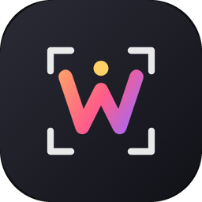

<p align="center">
  
</p>

<h1 align="center">Wallpaper Editor</h1>

<p align="center">
  <a href="https://github.com/AnxoBT/wallpaper-editor/releases/latest"></a>
  
  
  
</p>

<br>

<details open>
<summary><b>English</b></summary>

<br>

<p align="center">Make any photo fit your screen, then turn your gallery into a live wallpaper.</p>

<p align="center"><a href="https://github.com/AnxoBT/wallpaper-editor/releases/latest"><b>Download the APK</b></a></p>

<table>
  <tr>
    <td width="33%" valign="top">
      <h3>🎨 Editor</h3>
      Fits any image to your exact screen resolution. Crop, expand with smart fill, remove objects or text with on-device AI, and save over the original without changing its place in the gallery.
    </td>
    <td width="33%" valign="top">
      <h3>🖼️ Live wallpaper</h3>
      Cycles through your folders. Double tap for the next photo, triple tap to go back, or let it change on its own. No battery use in the background.
    </td>
    <td width="33%" valign="top">
      <h3>🕒 Clock widget</h3>
      A home-screen clock with your choice of font, size and date, in a colour that adapts to each wallpaper.
    </td>
  </tr>
</table>


### Features

**Editor**

- **Frame**: target resolution (your screen's by default); move, zoom and rotate with gestures or
  in precise steps (1 px, 1 %, 0.1°); fill empty areas with blur, white or black
- **Crop** freely or to a fixed ratio, and **Expand** any side: a clean background, or new texture (clouds, stars, grain, gradients) invented from the photo without repeating patterns
- **Heal**: remove spots, objects, signatures and text using on-device AI; **Blend** and **Shuffle** brushes to retouch joins and textures by hand
- **Layers**: place other images on top, then keep editing the combined result
- Filters, adjustments, curves, HDR, lens blur, selective brush, vignette and grain
- Undo history, compare with the original, and save as a copy (next to the original) or
  **replace the original** (same name, date and position in its folder)
- Recently edited photos one tap away in the photo picker, and a warning before leaving with
  unsaved changes

**Tags**

- Tag photos with as many labels as you like (series, anime, a character…) and mark favourites;
  tags live in the app, your photos are never modified
- Search and filter by several tags at once, both in the photo picker and in the wallpaper list
- Create, rename or delete tags, and import or export them as JSON
- Copies saved from the editor keep the original's tags

**Live wallpaper**

- Whole folders (new photos are added automatically), selected photos or every photo with a tag
- Double and triple tap on the home screen, each with its own action: next, previous, random
  photo or pause/resume the automatic change
- Shuffle or sequential order, automatic change on unlock or on a timer
- Home screen only, or home and lock screen
- Per-source schedule: always, daytime, night, weekdays or weekend
- Edit or delete the current wallpaper photo from inside the app, and list the photos whose shape
  doesn't match your screen so you can fix them in the editor

**Clock widget**

- Several fonts and sizes, date above or below, 12/24 h, shadow and alignment
- Colour that adapts to each wallpaper; freely resizable

**Settings**

- English and Spanish; follows your phone's language by default

### Windows version

The same editor, tags and tag search run on Windows, and the wallpaper part becomes a desktop slideshow. Download the installer or the portable zip from the release.

- Photos come from folders you choose (Pictures at first); tags use the same JSON file as the phone, matched by file name
- The mouse wheel zooms and Shift + wheel rotates, where the phone uses pinch and two fingers
- The slideshow changes while the app is open or in the system tray
- Not on Windows: AI healing and text detection (classic healing is there), the clock widget, tap gestures and the lock screen
- It is not signed, so Windows SmartScreen may warn the first time

### Install

Download the APK from the [latest release](https://github.com/AnxoBT/wallpaper-editor/releases/latest)
and open it on your phone (Android 8.0 or later; allow installing from unknown sources when asked).
The APK is signed with a debug key, so it is meant for manual installs, not the Play Store.

### Tested on

Developed and tested on a **vivo V40 SE** (Android 14, 1080 × 2400). It includes a few tweaks for
vivo phones: the clock widget can copy the vivo lock-screen clock (it reads its font, weight and
colour from the system), the lock-screen wallpaper is
applied when you leave the home screen so double tap keeps working, and clocks with custom fonts
are drawn as images because the vivo launcher cannot load them. Other phones get standard Android
behaviour.

### Build

Requires JDK 17 and the Android SDK (compile/target SDK 35, min SDK 26).

```sh
./gradlew assembleRelease           # APK in app/build/outputs/apk/release/
./gradlew testReleaseUnitTest        # unit tests
./gradlew ktlintCheck                # code style (ktlintFormat fixes it)
```

Clock widget layouts are generated by `python tools/gen_clock_layouts.py`.

### How it works

- **Smart fill** (Expand and Heal): multi-scale patch synthesis based on PatchMatch, with detail
  restored at full resolution and tone matched along the seam.
- **On-device AI**: [MI-GAN](https://github.com/Picsart-AI-Research/MI-GAN) (MIT) running with
  LiteRT on the GPU, with CPU fallback. Text detection uses on-device ML Kit.
- **Your data**: settings survive app updates. Android backup only keeps preferences that work on
  any phone, plus photo tags (stored by file name); chosen folders and photos are not backed up,
  because their permissions only apply to the phone where they were granted.

### Credits

Clock fonts are licensed under the SIL Open Font License. The lock-screen style uses the phone's
own lock-screen font when the system exposes it (vivo), and Playfair Display Black otherwise. All open-source licences can be read in the app under **Settings → Open-source licences**.

</details>

<details>
<summary><b>Español</b></summary>

<br>

<p align="center">Adapta cualquier foto a tu pantalla y convierte tu galería en un fondo de pantalla dinámico.</p>

<p align="center"><a href="https://github.com/AnxoBT/wallpaper-editor/releases/latest"><b>Descargar el APK</b></a></p>

<table>
  <tr>
    <td width="33%" valign="top">
      <h3>🎨 Editor</h3>
      Adapta cualquier imagen a la resolución exacta de tu pantalla. Recorta, expande con relleno inteligente, borra objetos o textos con IA en el móvil y guarda encima del original sin cambiar su sitio en la galería.
    </td>
    <td width="33%" valign="top">
      <h3>🖼️ Fondo dinámico</h3>
      Va pasando las fotos de tus carpetas. Doble toque para la siguiente, triple para volver, o deja que cambie sola. Sin consumo en segundo plano.
    </td>
    <td width="33%" valign="top">
      <h3>🕒 Widget de reloj</h3>
      Un reloj para el escritorio con la fuente, el tamaño y la fecha que elijas, en un color que se adapta a cada fondo.
    </td>
  </tr>
</table>


### Funciones

**Editor**

- **Encuadre**: resolución de destino (por defecto la de tu pantalla); mover, ampliar y girar con
  gestos o en pasos precisos (1 px, 1 %, 0,1°); rellenar los huecos con desenfoque, blanco o negro
- **Recortar** libre o con proporción fija, y **Expandir** cualquier lado: fondo limpio, o textura nueva (nubes, estrellas, grano, degradados) inventada a partir de la foto sin repetir patrones
- **Corrector**: borra manchas, objetos, firmas y textos con IA en el propio móvil; pinceles **Mezclar** y **Revolver** para retocar uniones y texturas a mano
- **Capas**: pon otras imágenes encima y sigue editando el resultado combinado
- Filtros, ajustes, curvas, HDR, desenfoque de lente, pincel selectivo, viñeta y grano
- Historial para deshacer, comparar con el original y guardar como copia (junto a la original)
  o **reemplazar el original** (mismo nombre, fecha y posición en su carpeta)
- Fotos editadas hace poco a un toque en el selector, y aviso antes de salir con cambios sin
  guardar

**Etiquetas**

- Pon a cada foto las etiquetas que quieras (series, anime, un personaje…) y márcala como
  favorita; las etiquetas se guardan en la app, tus fotos no se tocan
- Busca y filtra por varias etiquetas a la vez, en el selector de fotos y en la lista de fondos
- Crea etiquetas, cámbiales el nombre o bórralas, e impórtalas o expórtalas en JSON
- Las copias guardadas desde el editor conservan las etiquetas de la original

**Fondo dinámico**

- Carpetas enteras (las fotos nuevas entran solas), fotos sueltas o todas las de una etiqueta
- Doble y triple toque en el escritorio, cada uno con su acción: siguiente, anterior, foto al
  azar o pausar/reanudar el cambio automático
- Orden aleatorio o secuencial, cambio automático al desbloquear o cada cierto tiempo
- Solo en el escritorio, o también en la pantalla de bloqueo
- Horario por fuente: siempre, de día, de noche, entre semana o fin de semana
- Editar o borrar la foto del fondo actual desde la propia app, y ver qué fotos no tienen la forma
  de tu pantalla para arreglarlas en el editor

**Widget de reloj**

- Varias fuentes y tamaños, fecha encima o debajo, 12/24 h, sombra y alineación
- Color que se adapta a cada fondo; tamaño ajustable

**Ajustes**

- Inglés y español; por defecto usa el idioma de tu móvil

### Versión de Windows

El mismo editor, las etiquetas y su búsqueda funcionan en Windows, y la parte de fondos pasa a ser un pase en el escritorio. Descarga el instalador o el zip portable desde la release.

- Las fotos salen de las carpetas que elijas (al principio, Imágenes); las etiquetas usan el mismo JSON que el móvil y van por nombre de archivo
- La rueda del ratón hace zoom y Mayús + rueda gira, donde el móvil usa pellizco y dos dedos
- El pase cambia mientras la app está abierta o en la bandeja del sistema
- No está en Windows: Corrector con IA y detección de texto (sí el Corrector clásico), widget del reloj, gestos con toques y pantalla de bloqueo
- No está firmada, así que Windows SmartScreen puede avisar la primera vez

### Instalar

Descarga el APK de la [última versión](https://github.com/AnxoBT/wallpaper-editor/releases/latest)
y ábrelo en el móvil (Android 8.0 o superior; permite instalar apps de origen desconocido si te lo
pide). El APK está firmado con una clave de depuración: sirve para instalarlo a mano, no para Play
Store.

### Probado en

Desarrollada y probada en un **vivo V40 SE** (Android 14, 1080 × 2400). Incluye algunos ajustes
para móviles vivo: el widget puede copiar el reloj de bloqueo de vivo (lee del sistema su fuente,
grosor y color), el fondo de bloqueo se
aplica al salir del escritorio para que el doble toque siga funcionando, y los relojes con fuentes
propias se dibujan como imagen porque el escritorio de vivo no las carga. En otros móviles usa el
comportamiento estándar de Android.

### Compilar

Necesita JDK 17 y el Android SDK (compile/target SDK 35, min SDK 26).

```sh
./gradlew assembleRelease           # APK en app/build/outputs/apk/release/
./gradlew testReleaseUnitTest        # tests
./gradlew ktlintCheck                # estilo de código (ktlintFormat lo corrige)
```

Los diseños del widget de reloj se generan con `python tools/gen_clock_layouts.py`.

### Cómo funciona

- **Relleno inteligente** (Expandir y Corrector): síntesis por parches multiescala basada en
  PatchMatch, recuperando el detalle a resolución completa y ajustando el tono en la unión.
- **IA en el dispositivo**: [MI-GAN](https://github.com/Picsart-AI-Research/MI-GAN) (MIT) con
  LiteRT en la GPU, o en la CPU si no hay compatible. El reconocimiento de texto usa ML Kit en el
  propio móvil.
- **Tus datos**: los ajustes se conservan al actualizar. La copia de seguridad de Android solo
  guarda las preferencias que sirven en cualquier móvil y las etiquetas de las fotos (por nombre de
  archivo); las carpetas y fotos elegidas no, porque sus permisos solo valen en el móvil donde se
  dieron.

### Créditos

Las fuentes del reloj tienen licencia SIL Open Font License. El estilo de bloqueo usa la fuente
del reloj de bloqueo del propio móvil cuando el sistema la deja leer (vivo), y si no, Playfair
Display Black. Todas las licencias de código abierto se pueden leer en la app, en
**Ajustes → Licencias de código abierto**.

</details>
